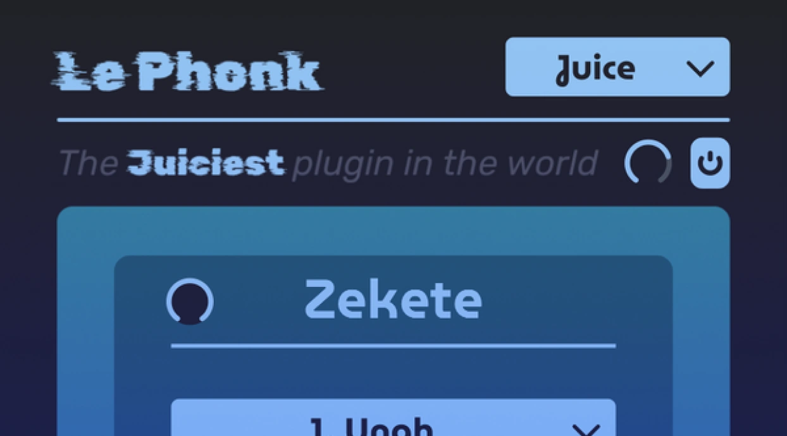

# Le Phonk

Le Phonk is the only plugin you will ever need.

Checkout the [product page](https://www.xynth.audio/plugins/lephonk) and [manual](https://www.xynth.audio/docs/plugins/lephonk).



## Building

### Option 1: Jucer
This option is now deprecated, as I have moved the project over to CMake. As a result the jucer project may or may not be up to date.

### Option 2: CMake

- Visual Studio: Run `cmake -B Builds`
- XCode: Run `cmake -B Builds -G Xcode`
- CLion: Simply open the project in CLion

OR

- Python: Simply run `python build.py --skip-bundle`

> Assumes you have Python 3 and the various libraries installed

## Bundling

This includes code-signing and building the installer on Windows and MacOS

1. Create a `.env` file in the root directory with the following:

Windows:
```env
PLUGIN_NAME="LePhonk"

ISCC_PATH="C:/Program Files (x86)/Inno Setup 6/ISCC.exe"
SEVEN_ZIP_PATH="C:/Program Files/7-Zip/7z.exe"

SIGNTOOL_PATH="C:/Program Files (x86)/Windows Kits/10/bin/10.0.22621.0/x64/signtool.exe"
AZURE_DLIB_PATH="C:/Program Files (x86)/Microsoft/ArtifactSigningClientTools/bin/x64/Azure.CodeSigning.Dlib.dll"
```

MacOS:
```env
PLUGIN_NAME="LePhonk"
COMPANY_NAME="Xynth Audio"

DEVELOPER_NAME="Developer name goes here"
TEAM_ID="TEAM ID GOES HERE"
APPLE_ID="apple ID email goes here"

SIGNING_PASSWORD="singing-password-goes-here"
```

2. Run `python build.py`

## License

MIT
